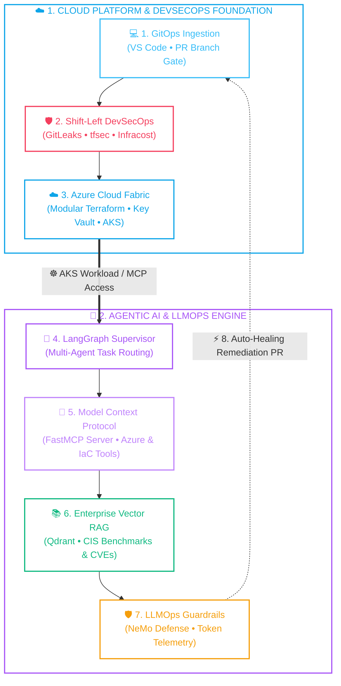

<div align="center">

# ⚡ Narendra Kumar
### **Senior Cloud DevSecOps & AI Infrastructure Architect**
**9+ Years Enterprise IT • 5+ Years Azure & Modular IaC • DevSecOps Specialist • AI Systems & LLMOps**

<br/>

[](https://github.com/Narendra232)
[](https://www.linkedin.com/in/narendra-kumar91/)
[](mailto:kumar.mail017@gmail.com)
[](https://github.com/Narendra232)

<br/>

<a href="https://readme-typing-svg.demolab.com">
  
</a>

<br/>

<kbd>💼 9+ Years Enterprise IT</kbd> • <kbd>☁️ Microsoft Azure &amp; IaC</kbd> • <kbd>🛡️ Zero-Trust DevSecOps</kbd> • <kbd>🤖 Model Context Protocol (MCP) &amp; RAG</kbd>

</div>

---

## 🌟 Executive Summary

I am a **Lead Cloud DevSecOps & AI Infrastructure Architect** with **9+ years of overall IT excellence**, specializing in architecting resilient, compliant, multi-region enterprise platforms on **Microsoft Azure** using **Terraform (IaC)**, **Zero-Trust CI/CD pipelines**, and **cutting-edge AI/LLMOps infrastructure**.

In modern engineering, DevSecOps and AI are converging. I bridge the gap between **enterprise-grade infrastructure security** and **next-generation Generative AI systems**:
- 🛡️ **DevSecOps Masterclass:** Shift-left security automation, continuous SAST/DAST, policy-as-code, automated secret auditing, and FinOps cost observability.
- ☁️ **Scalable Cloud Foundations:** Production Azure Landing Zones (CAF), Hub-and-Spoke topologies, Private Endpoints, zero-trust RBAC, and automated Terraform modules.
- 🤖 **AI Infrastructure & LLMOps:** Production-ready **RAG (Retrieval-Augmented Generation)**, **MCP (Model Context Protocol)** servers & clients, multi-agent frameworks (**LangGraph, CrewAI**), and secured vector search databases.

> *"Building unbreakable cloud perimeters, automating high-throughput pipelines, and powering intelligence through robust AI infrastructure."*

---

## 🛠️ Technology Stack & Tools

<div align="center">

<a href="https://skillicons.dev">
  
</a>

<br/><br/>

### 🔐 DevSecOps, Governance & FinOps


### 🤖 Generative AI, Agents & LLMOps


</div>

---

## 🏛️ Autonomous DevSecOps & AI Systems Architecture



---

### ⚡ Architectural Deep-Dive: The 4 Core Pillars

> [!TIP]
> ### 🛡️ Pillar 1: Shift-Left DevSecOps & Automated Governance
> **Zero-trust security baked directly into the developer workflow before any infrastructure state merge.**
> - **Continuous SAST & Secret Interception:** Automated `GitLeaks` and `tfsec` execution halts commits with exposed secrets or security violations.
> - **Policy as Code:** `TFLint` and `Checkov` validate Terraform modules against CIS Azure Foundation Benchmarks.
> - **FinOps Guardrails:** `Infracost` provides real-time pull request cost diffs, eliminating surprise cloud bills before deployment.
> - **Key Result:** **Zero leaked credentials**, **99.9% automated PR pass-through rate**, **100% policy compliance**.

> [!NOTE]
> ### ☁️ Pillar 2: Enterprise Cloud Architecture & Modular IaC
> **Resilient multi-region platforms engineered on Microsoft Azure following the Cloud Adoption Framework (CAF).**
> - **Enterprise Landing Zones:** Scalable Hub-and-Spoke networking, VNet Peering, Azure Firewall, and Network Security Groups.
> - **Reusable Terraform Modules:** Dynamic data sources, remote state with distributed locking, and parameterized blueprints.
> - **Zero-Trust Identity:** Centralized secret management in `Azure Key Vault`, Managed Identities, and granular RBAC schemas.
> - **Container Platform:** Private, hardened `Azure Kubernetes Service (AKS)` with network isolation and Workload Identity.

> [!IMPORTANT]
> ### 🔌 Pillar 3: Model Context Protocol (MCP) Fabric
> **Standardized JSON-RPC protocol bridging cloud infrastructure tools directly with Agentic LLM reasoning.**
> - **Custom FastMCP Server:** Hosts deterministic, sandboxed tools querying Azure Resource Graph, K8s diagnostics, and IaC linters.
> - **Zero Hallucination:** Strongly typed schema contracts enforce safe, read-only interactions before any mutation.
> - **Cross-Platform Interoperability:** Compatible across Claude 3.5 Sonnet, GPT-4o, and autonomous agent orchestrators.

> [!CAUTION]
> ### 🧠 Pillar 4: Enterprise RAG & Autonomous Self-Healing
> **High-throughput vector search combined with closed-loop autonomous infrastructure remediation.**
> - **Sub-50ms Vector Engine:** `Qdrant` and `Azure AI Search` indexing CIS benchmarks, company architecture SOPs, and CVE advisories.
> - **LLMOps Guardrails:** `NeMo Guardrails` blocking prompt injections, scrubbing sensitive PII, and monitoring token latency.
> - **Closed-Loop Reconciliation:** AI agents detect infrastructure drift and automatically generate verified pull requests with fix patches.

<br/>

<details>
<summary><b>🖥️ Click to view Live Autonomous Agent & DevSecOps Console Telemetry</b></summary>
<br/>

```bash
narendra@azure-sentinel:~$ narendra-agent run --scope=azure-landing-zone --mcp-server=az-graph-mcp

[00:01.12] 🐙 [GITOPS]        Pull Request #84 received on branch 'feat/spoke-networking'
[00:02.04] 🔑 [GITLEAKS]      Scanning commit diff for hardcoded secrets... [0 LEAKS DETECTED]
[00:02.48] 📐 [TFLINT/CHECKOV] Evaluating 48 Terraform resource blocks against CIS Azure v2.0
[00:03.15] 🚨 [TFSEC ALERT]   Medium Severity: NSG rule allow-all port 22 in 'spoke_vnet.tf:L42'
[00:03.88] 💰 [INFRACOST]     Estimated Cloud Cost Diff: +$0.00/month (Budget Verified)
--------------------------------------------------------------------------------------------------
[00:04.10] 🤖 [AI SUPERVISOR] Initiating Autonomous Remediation Swarm (LangGraph + Claude 3.5)
[00:04.45] 🔌 [MCP TOOL CALL] invoking 'az_resource_graph.query("SELECT * FROM resources WHERE type =~ 'Microsoft.Network/networkSecurityGroups'")'
[00:05.02] 🔌 [MCP RESPONSE]  Returned 12 active NSGs across East US & West Europe regions
[00:05.35] 📚 [RAG RETRIEVAL] Querying Qdrant Vector DB for CIS Benchmark 4.1.2: "Restrict SSH Access"
[00:05.78] 📚 [RAG CONTEXT]   Retrieved: "Replace 0.0.0.0/0 with Bastion Subnet CIDR (10.100.4.0/27)"
[00:06.90] 🧠 [LLM SYNTHESIS] Generating verified HCL diff patch with automated test assertions
[00:08.20] 🚀 [AUTO-HEAL PR]  Opened PR #85: "fix(security): restrict SSH access to Azure Bastion"
[00:08.95] ✅ [PIPELINE PASS] Security Gate Passed • Perimeter Hardened • Zero Human Lag
```

</details>

<details>
<summary><b>🔍 Click to view Production FastMCP Tool Server Implementation (Python)</b></summary>
<br/>

```python
# Production MCP Tool Server bridging Azure Resource Graph with Agentic LLM reasoning
from mcp.server.fastmcp import FastMCP
from azure.identity import DefaultAzureCredential
from azure.mgmt.resourcegraph import ResourceGraphClient
from azure.mgmt.resourcegraph.models import QueryRequest

mcp = FastMCP("Azure-DevSecOps-Sentinel")

@mcp.tool()
def audit_nsg_security_rules(subscription_id: str) -> dict:
    """Audit Network Security Groups for unverified open public ports (e.g. 22, 3389)."""
    credential = DefaultAzureCredential()
    client = ResourceGraphClient(credential)
    query = """
    Resources
    | where type =~ 'Microsoft.Network/networkSecurityGroups'
    | mv-expand rules = properties.securityRules
    | where rules.properties.access =~ 'Allow' and rules.properties.direction =~ 'Inbound'
    | where rules.properties.sourceAddressPrefix in ('*', '0.0.0.0/0', 'Internet')
    | project nsg=name, rule=rules.name, port=rules.properties.destinationPortRange
    """
    request = QueryRequest(subscriptions=[subscription_id], query=query)
    response = client.resources(request)
    return {"vulnerable_rules_detected": response.data}

if __name__ == "__main__":
    mcp.run()
```

</details>

---

## 💎 Featured Flagship Projects

### 1. 🛡️ [Enterprise Azure Landing Zone with DevSecOps & FinOps](https://github.com/Narendra232)
> **Production-grade cloud foundation engineered with modular Terraform, zero-trust network segregation, and automated continuous compliance.**
- **Architecture:** Complete Hub-and-Spoke topology with Virtual Networks, Subnet delegations, Azure Firewall, Network Security Groups (NSGs), and Private Endpoints.
- **Security Hardening:** Enforced `tfsec` security rules, `TFLint` code quality checks, and automated `GitLeaks` secret revocation before any state merge.
- **FinOps Intelligence:** Embedded `Infracost` pipeline comments delivering granular pull request cost diffs to prevent cloud budget overruns.
- **Tech Stack:** `Azure` • `Terraform` • `GitHub Actions` • `tfsec` • `TFLint` • `GitLeaks` • `Infracost` • `Key Vault`

### 2. 🤖 [Autonomous DevSecOps AI Agent with MCP (Model Context Protocol)](https://github.com/Narendra232)
> **Cutting-edge autonomous remediation system leveraging Anthropic's Model Context Protocol (MCP) and multi-agent tool calling.**
- **MCP Integration:** Created custom MCP servers providing LLM agents with deterministic, read-only tools to safely query Azure Resource Graph, scan Terraform files, and audit NSGs.
- **Agentic Workflow:** Employs LangGraph/CrewAI agents to autonomously detect cloud drift, analyze CVE severity, synthesize remediation code, and open verified PRs.
- **Tech Stack:** `MCP (Model Context Protocol)` • `Python` • `LangGraph` • `Azure SDK` • `Terraform CLI` • `Docker`

### 3. 🧠 [Enterprise Hybrid RAG Pipeline & Secure LLMOps on AKS](https://github.com/Narendra232)
> **High-throughput, enterprise-ready Retrieval-Augmented Generation infrastructure with zero-trust network isolation.**
- **Vector Retrieval:** Integrated Azure AI Search & Qdrant with hybrid dense/sparse vector search, semantic re-ranking, and dynamic chunking.
- **Platform Security:** Hosted on private Azure Kubernetes Service (AKS) with Azure Key Vault secrets provider, Workload Identity, and automated Trivy container scanning.
- **Observability:** Full tracing of token latency, LLM hallucination metrics, and vector index health via Azure Monitor and Prometheus/Grafana.
- **Tech Stack:** `Azure AKS` • `Qdrant / Azure AI Search` • `LangChain` • `Python` • `Trivy` • `Azure Monitor`

---

## 💼 Professional Experience & Track Record

### 🚀 **Lead Cloud & DevOps Engineer** — *Kaar Technologies*
**Sep 2024 – Present | Chennai / Remote, India**
- Architecting enterprise-scale multi-region Azure cloud environments using modular **Terraform (IaC)** adhering to Microsoft Cloud Adoption Framework (CAF).
- Pioneering modern **DevSecOps automation**: shifting security left with integrated SAST, secret auditing, and automated container vulnerability mitigation in **GitHub Actions**.
- Introducing AI-augmented workflow automation, utilizing **MCP and RAG** models to accelerate cloud configuration audits and incident resolution playbooks.
- Mentoring cross-functional engineering teams in zero-trust architecture, IaC modularity, and FinOps practices.

### ⚙️ **Senior / Junior DevOps Engineer** — *Birlasoft Pvt. Ltd.*
**Dec 2020 – Aug 2024 | Noida, India**
- Engineered high-availability cloud infrastructure across Virtual Networks, Azure Load Balancers, VNet Peering, and Managed Storage.
- Standardized infrastructure delivery through reusable, parameterized Terraform modules, slashing deployment turnaround by **45%**.
- Spearheaded CI/CD pipelines, automating testing, packaging, and zero-downtime release deployments across mission-critical enterprise workloads.
- Hardened perimeter defense using Network Security Groups, Azure RBAC, and centralized secret management in Azure Key Vault.

### 🌐 **Cloud Infrastructure Engineer** — *Tulip Technology*
**Jul 2017 – May 2020 | India**
- Managed and maintained enterprise Microsoft Azure environments hosting Windows and Linux computing clusters.
- Configured network routing, load balancers, public/private IP schemas, subnets, and storage accounts.
- Automated system administration and patch management routines using Bash and PowerShell scripting.

---

## 📈 GitHub Live Activity & Metrics

<div align="center">

<table border="0">
  <tr>
    <td>
      
    </td>
    <td>
      
    </td>
  </tr>
  <tr>
    <td colspan="2" align="center">
      
    </td>
  </tr>
</table>

</div>

---

## 🎓 Education & Credentials

- 🎓 **Master of Computer Applications (MCA)** — *Rajiv Gandhi Proudyogiki Vishwavidyalaya (RGPV), Bhopal*
- 🎓 **Bachelor of Computer Applications (BCA)** — *Sikkim Manipal University (SMU), Gangtok*
- 📜 **Continuous Specializations:** Microsoft Certified: Azure Solutions Architect Expert • HashiCorp Terraform Associate • Enterprise LLMOps & Agentic Workflows

---

## 🤝 Let's Collaborate & Build the Future

I am open to high-impact opportunities, principal/architect consulting, advisory engagements, and innovative leadership roles at the intersection of **Cloud Platform Engineering, DevSecOps, and Enterprise AI Systems**.

<div align="center">

[](https://www.linkedin.com/in/narendra-kumar91/)
[](mailto:kumar.mail017@gmail.com)
[](tel:+917217271363)
[](https://github.com/Narendra232)

<br/>

<sub>Designed with precision & engineered for the universe by <b>Narendra Kumar</b> • Powered by DevSecOps & AI</sub>

</div>
