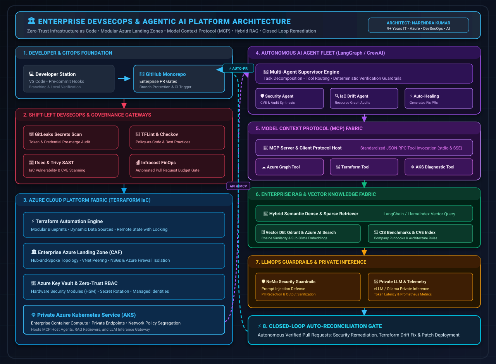
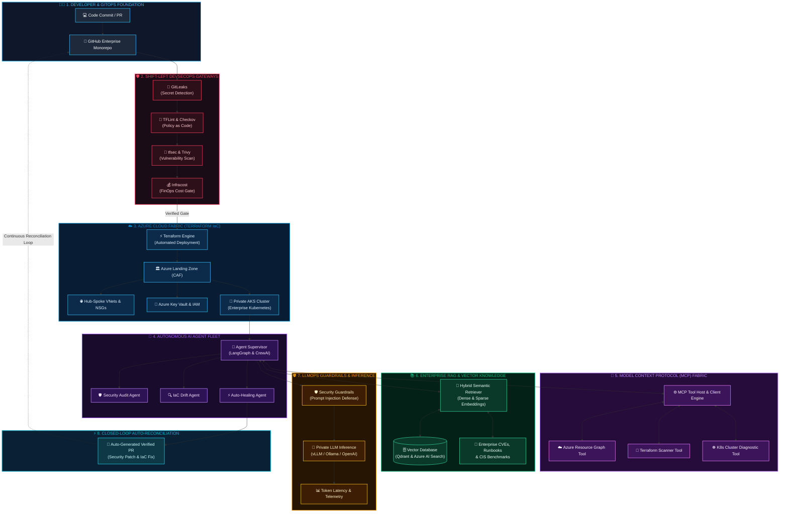

# ⚡ Narendra Kumar
### **Senior Cloud DevSecOps & AI Infrastructure Architect**
**9+ Years of Enterprise IT Experience | 5+ Years in Azure, Modular IaC & DevSecOps | AI Systems & LLMOps**

---

---

## 🌟 Executive Overview

I am a **Lead Cloud DevSecOps & AI Infrastructure Architect** with **9+ years of overall IT excellence**, specializing in architecting resilient, compliant, multi-region enterprise platforms on **Microsoft Azure** using **Terraform (IaC)**, **Zero-Trust CI/CD pipelines**, and **cutting-edge AI/LLMOps infrastructure**.

In modern engineering, DevSecOps and AI are converging. I bridge the gap between **enterprise-grade infrastructure security** and **next-generation Generative AI systems**:
- 🛡️ **DevSecOps Masterclass:** Shift-left security automation, continuous SAST/DAST, policy-as-code, automated secret auditing, and FinOps cost observability.
- ☁️ **Scalable Cloud Foundations:** Production Azure Landing Zones (CAF), Hub-and-Spoke topologies, Private Endpoints, zero-trust RBAC, and automated Terraform modules.
- 🤖 **AI Infrastructure & LLMOps:** Production-ready **RAG (Retrieval-Augmented Generation)**, **MCP (Model Context Protocol)** servers & clients, multi-agent frameworks (**LangGraph, CrewAI**), and secured vector search databases.

> *"Building unbreakable cloud perimeters, automating high-throughput pipelines, and powering intelligence through robust AI infrastructure."*

---

## 🛠️ Technology Stack & Core Competencies

### ☁️ Cloud & Platform Engineering

-326CE5?style=for-the-badge&logo=kubernetes&logoColor=white)

### 🔐 DevSecOps, Governance & FinOps

### 🤖 Generative AI, Agents & LLMOps

### 🔄 CI/CD & Observability

---

## 🏛️ End-to-End Enterprise Architecture

 

<i>Click the diagram above or use the badge to open and edit the full model in <b>Draw.io (diagrams.net)</b>.</i>

<b>🔍 Click to view interactive Mermaid text diagram representation</b>

 

---

## 💎 Featured Flagship Projects

### 1. 🛡️ [Enterprise Azure Landing Zone with DevSecOps & FinOps](https://github.com/Narendra232)
> **Production-grade cloud foundation engineered with modular Terraform, zero-trust network segregation, and automated continuous compliance.**
- **Architecture:** Complete Hub-and-Spoke topology with Virtual Networks, Subnet delegations, Azure Firewall, Network Security Groups (NSGs), and Private Endpoints.
- **Security Hardening:** Enforced `tfsec` security rules, `TFLint` code quality checks, and automated `GitLeaks` secret revocation before any state merge.
- **FinOps Intelligence:** Embedded `Infracost` pipeline comments delivering granular pull request cost diffs to prevent cloud budget overruns.
- **Tech Stack:** `Azure` • `Terraform` • `GitHub Actions` • `tfsec` • `TFLint` • `GitLeaks` • `Infracost` • `Key Vault`

### 2. 🤖 [Autonomous DevSecOps AI Agent with MCP (Model Context Protocol)](https://github.com/Narendra232)
> **Cutting-edge autonomous remediation system leveraging Anthropic's Model Context Protocol (MCP) and multi-agent tool calling.**
- **MCP Integration:** Created custom MCP servers providing LLM agents with deterministic, read-only tools to safely query Azure Resource Graph, scan Terraform files, and audit NSGs.
- **Agentic Workflow:** Employs LangGraph/CrewAI agents to autonomously detect cloud drift, analyze CVE severity, synthesize remediation code, and open verified PRs.
- **Tech Stack:** `MCP (Model Context Protocol)` • `Python` • `LangGraph` • `Azure SDK` • `Terraform CLI` • `Docker`

### 3. 🧠 [Enterprise Hybrid RAG Pipeline & Secure LLMOps on AKS](https://github.com/Narendra232)
> **High-throughput, enterprise-ready Retrieval-Augmented Generation infrastructure with zero-trust network isolation.**
- **Vector Retrieval:** Integrated Azure AI Search & Qdrant with hybrid dense/sparse vector search, semantic re-ranking, and dynamic chunking.
- **Platform Security:** Hosted on private Azure Kubernetes Service (AKS) with Azure Key Vault secrets provider, Workload Identity, and automated Trivy container scanning.
- **Observability:** Full tracing of token latency, LLM hallucination metrics, and vector index health via Azure Monitor and Prometheus/Grafana.
- **Tech Stack:** `Azure AKS` • `Qdrant / Azure AI Search` • `LangChain` • `Python` • `Trivy` • `Azure Monitor`

---

## 💼 Professional Experience & Track Record

### 🚀 **Lead Cloud & DevOps Engineer** — *Kaar Technologies*
**Sep 2024 – Present | Chennai / Remote, India**
- Architecting enterprise-scale multi-region Azure cloud environments using modular **Terraform (IaC)** adhering to Microsoft Cloud Adoption Framework (CAF).
- Pioneering modern **DevSecOps automation**: shifting security left with integrated SAST, secret auditing, and automated container vulnerability mitigation in **GitHub Actions**.
- Introducing AI-augmented workflow automation, utilizing **MCP and RAG** models to accelerate cloud configuration audits and incident resolution playbooks.
- Mentoring cross-functional engineering teams in zero-trust architecture, IaC modularity, and FinOps practices.

### ⚙️ **Senior / Junior DevOps Engineer** — *Birlasoft Pvt. Ltd.*
**Dec 2020 – Aug 2024 | Noida, India**
- Engineered high-availability cloud infrastructure across Virtual Networks, Azure Load Balancers, VNet Peering, and Managed Storage.
- Standardized infrastructure delivery through reusable, parameterized Terraform modules, slashing deployment turnaround by **45%**.
- Spearheaded CI/CD pipelines, automating testing, packaging, and zero-downtime release deployments across mission-critical enterprise workloads.
- Hardened perimeter defense using Network Security Groups, Azure RBAC, and centralized secret management in Azure Key Vault.

### 🌐 **Cloud Infrastructure Engineer** — *Tulip Technology*
**Jul 2017 – May 2020 | India**
- Managed and maintained enterprise Microsoft Azure environments hosting Windows and Linux computing clusters.
- Configured network routing, load balancers, public/private IP schemas, subnets, and storage accounts.
- Automated system administration and patch management routines using Bash and PowerShell scripting.

---

## 📊 Deep-Dive Competency Matrix

| Strategic Area | Enterprise Capabilities & Tech Stack |
| :--- | :--- |
| **Cloud Architecture** | Microsoft Azure, Hub-and-Spoke Networking, Azure Landing Zones, Storage, Compute, Key Vault |
| **Infrastructure as Code** | Terraform (Modules, Workspaces, Remote State, Dynamic Data Sources), Terragrunt, ARM/Bicep |
| **DevSecOps & SAST** | tfsec, TFLint, GitLeaks, Trivy, Checkov, SonarQube, OPA / Conftest, Shift-Left Enforcement |
| **FinOps & Cost Control** | Infracost, Azure Cost Management, Resource Tagging Governance, Idle Resource Automation |
| **AI Systems & LLMOps** | Model Context Protocol (MCP), Enterprise RAG, LangChain, LlamaIndex, Vector DBs, AI Agents |
| **Containers & Orchestration**| Docker, Kubernetes (AKS), Container Registry (ACR), Helm Charts, Microservices Hardening |
| **CI/CD & GitOps** | GitHub Actions, Reusable Workflows, Matrix Builds, Automated Rollbacks, Git Branching Strategies |
| **Scripting & Automation** | Python, Bash, PowerShell, Azure CLI, REST API Integrations |
| **Monitoring & SRE** | Azure Monitor, Log Analytics, Application Insights, Prometheus, Grafana, Incident Alerting |

---

## 📈 GitHub Live Activity & Metrics

<table border="0">
  <tr>
    <td>
      
    </td>
    <td>
      
    </td>
  </tr>
  <tr>
    <td colspan="2" align="center">
      
    </td>
  </tr>
</table>

---

## 🎓 Education & Credentials

- 🎓 **Master of Computer Applications (MCA)** — *Rajiv Gandhi Proudyogiki Vishwavidyalaya (RGPV), Bhopal*
- 🎓 **Bachelor of Computer Applications (BCA)** — *Sikkim Manipal University (SMU), Gangtok*
- 📜 **Continuous Specializations:** Microsoft Certified: Azure Solutions Architect Expert • HashiCorp Terraform Associate • Enterprise LLMOps & Agentic Workflows

---

## 🤝 Let's Collaborate & Build the Future

I am open to high-impact opportunities, principal/architect consulting, advisory engagements, and innovative leadership roles at the intersection of **Cloud Platform Engineering, DevSecOps, and Enterprise AI Systems**.

 

Designed with precision & engineered for the universe by <b>Narendra Kumar</b> • Powered by DevSecOps & AI

